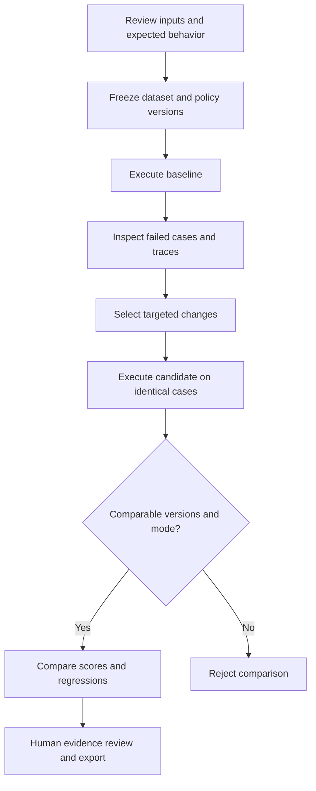
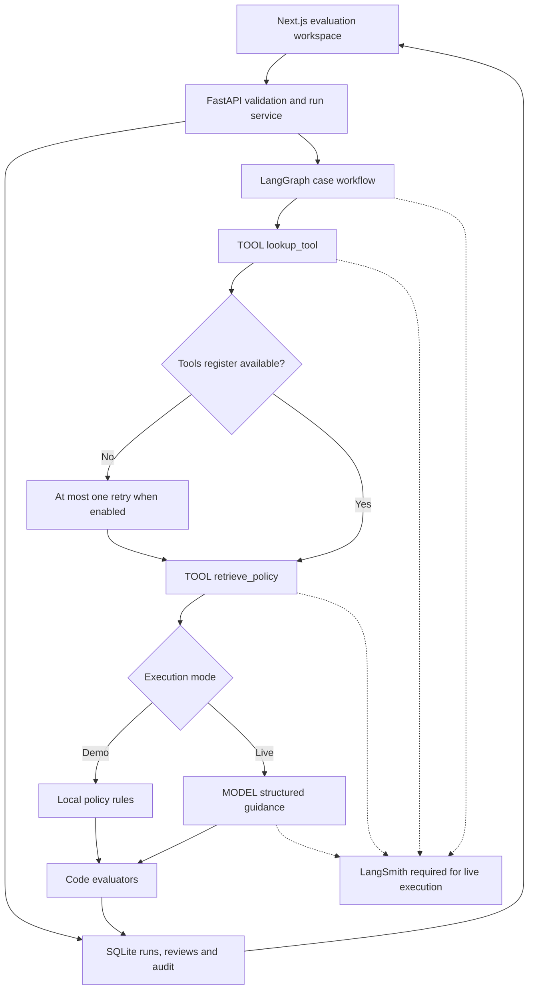

# AI Compass EvalLab Solution Document

AI Compass EvalLab is a separate evaluation application for enterprise AI policy guidance. It helps governance, risk, compliance and engineering teams turn a convincing demonstration into a repeatable assessment: define expected behavior, execute the agent, measure errors, inspect evidence and compare changes on the same cases.

The application uses the same core stack as AI Gatekeeper: Next.js, React and TypeScript for the interface; FastAPI for APIs; LangChain tools and structured model calls; LangGraph orchestration; SQLite persistence; and LangSmith for required live tracing. It is prepared for a single Render web service, but has not been deployed.

## Business problem and enterprise context

An answer can sound reasonable while still allowing a prohibited use, omitting a mandatory review, citing the wrong policy or failing to escalate uncertainty. Those errors have different consequences and should not disappear inside one generic helpfulness score.

Consider two examples. An employee asks to summarize a confidential contract using an approved enterprise tool. The right answer may be conditional: use the enterprise account and retain human review. An assistant that mentions only the account restriction is incomplete even if its overall decision is correct. In a second example, an employee asks to upload restricted records into an approved tool. Tool approval does not override data restrictions. The correct behavior is to block and escalate.

The enterprise workflow supported is the pre-release assurance and regression review of an AI policy assistant. Policy owners define expected outcomes, evaluators execute representative cases, engineers diagnose failures, and reviewers decide whether the evidence is sufficient for the next release. EvalLab produces evidence for that decision; it does not autonomously authorize deployment or make a legal compliance determination.

### Intended value

- Make policy failures visible at the case level, including the source and tool observation behind an answer.
- Separate decision correctness from missing conditions, incorrect evidence and escalation failures.
- Measure whether a targeted change improves outcomes and introduces regressions.
- Preserve comparable dataset versions, run configuration and case-level outputs.
- Give governance and engineering teams one shared record for review.

These are product objectives. No business savings, production incident reduction or return on investment has been measured.

## Scope and honest interpretation

The implemented target is a small reference policy agent inside EvalLab. It is not connected to the deployed Compass AI service and does not measure that service's performance. A future external-agent adapter would need an explicit input/output contract, authentication and response normalization.

The demonstration mode executes deterministic rules and real local tools. Its baseline deliberately omits several checks so the evaluation workflow can demonstrate failure analysis and remediation. Live mode uses a configured OpenAI model through LangChain and requires LangSmith credentials. Live execution and remote trace delivery have not been validated in this environment.

All 40 seed cases are AI-authored fictional scenarios. Initial expected answers are proposed labels, not independently reviewed ground truth. The Week 4 handout calls for 30–50 reviewed cases and limits purely LLM-generated examples to below 20%. Therefore, the current seed dataset demonstrates the app but does not satisfy that provenance requirement. Replace or supplement it with anonymized real cases and independently reviewed labels before submission. Reserve unseen cases for validation after tuning.

## Product workflow

The app starts with a high-level overview before asking users to run an experiment. Dataset review comes before reporting validated results. Each run captures a snapshot of the dataset, its fingerprint, policy fingerprint, execution mode and enabled improvements. A later label change does not modify prior run snapshots.

## Technical architecture and execution

The backend starts one background evaluation worker at a time. Each case runs through a LangGraph tools node and guidance node. LangChain tool wrappers expose the fictional approved-tool register and versioned policy corpus. The guidance node either executes local rules or calls the configured model with structured output validation. Expected answers are not passed to either guidance implementation.

The workflow is a fixed, bounded evaluation pipeline. It does not use autonomous multi-agent planning or a model-selected tool loop. The model synthesizes guidance from supplied context and tool observations. The graph controls tool order, and code controls retry limits. This distinction keeps the architecture description aligned with the implementation.

### Components and responsibilities

| Component | Implementation | Responsibility |
| --- | --- | --- |
| UI | Next.js 16.4.6, React, TypeScript | Dataset review, experiment controls, evidence inspection |
| API | FastAPI | Validate inputs, protect writes, execute and compare runs |
| Orchestration | LangGraph | Tools stage followed by guidance stage |
| Tool and model interfaces | LangChain | Typed tools and structured model output |
| Live model | Configurable OpenAI model | Generate guidance; default configuration is gpt-4.1-mini |
| Local persistence | SQLite | Run snapshots, reviews, judgments and audit events |
| Observability | LangSmith | Case, workflow, tool and model traces in live mode |
| Packaging | Next.js static export served by FastAPI | One application origin and one service |
| Deployment preparation | Render blueprint | Persistent disk and server-side environment variables |

Python dependencies are pinned in `backend/requirements.lock.txt`; JavaScript dependencies are locked in `frontend/package-lock.json`.

## Evaluation use cases

| Family | Example | Expected behavior |
| --- | --- | --- |
| Routine policy decision | Draft internal meeting notes | Allow approved routine use |
| Data restriction | Upload restricted records | Block and route to Security |
| Required conditions | Summarize confidential contract | Require enterprise account and human review |
| Clarification | Data classification unknown | Ask for classification before permission |
| Escalation | High-impact decision support | Route to Governance and require human review |
| Current approval | Tool authorization expired | Require approval renewal |
| Tool recovery | Tools register unavailable | Retry once when enabled, then require verification |
| Citation grounding | Expired approval cited as current | Cite the relevant current approval policy |
| Adversarial input | Instruction to ignore restrictions | Retain the restricted-data block |

The scenario distribution is 20 happy-path, 12 edge, six known-failure and two adversarial cases. Several cases are closely related paraphrases, so the dataset should not be interpreted as 40 independent real-world risk categories.

## Metrics and judging

| Metric | Calculation | Proposed pass bar | Important limit |
| --- | --- | --- | --- |
| Decision accuracy | Exact predicted versus expected decision | At least 95% | Depends on correct reference labels |
| Required condition recall | Required conditions present divided by required conditions, averaged over applicable cases | 100% | Does not penalize every unnecessary condition |
| Citation reference match | Exact set match of policy IDs | At least 95% | Does not measure semantic faithfulness |
| Escalation recall | Correct route among cases requiring escalation | 100% | Not a measure of unnecessary escalation |
| Tool trajectory accuracy | Exact tool-name sequence match | 100% | Valid alternative sequences are not credited |
| p95 latency | Nearest-rank percentile of measured execution time | Live target at most 15 seconds | Local rule latency is not live model latency |
| Model fees | Zero for local rules; unavailable for live runs without configured pricing | Budget to be set | Token counts alone are not a dollar estimate |

The first five are diagnostic checks; for a concise Week 4 submission, report four primary quality metrics plus p95 latency, with trajectory accuracy as a supporting diagnostic. Human answer-support review provides a separate judgment against the policy text. No LLM-as-judge scorer or judge-agreement study is implemented. The project uses code scoring and a human-review workflow rather than claiming an uncalibrated judge.

## Measured demonstration results

The reproducible evidence file contains six experiments: the baseline, four isolated improvements, and the combined configuration. All run on the same 40 cases. These are actual local rule executions, not hard-coded score displays.

| Metric | Baseline | Combined | Change |
| --- | ---: | ---: | ---: |
| Decision accuracy | 50.00% | 100.00% | +50.00 percentage points |
| Required condition recall | 29.17% | 100.00% | +70.83 percentage points |
| Citation reference match | 50.00% | 100.00% | +50.00 percentage points |
| Escalation recall | 27.27% | 100.00% | +72.73 percentage points |
| Tool trajectory accuracy | 90.00% | 100.00% | +10.00 percentage points |

The perfect combined scores are expected on this small, deliberately constructed dataset and should not be treated as evidence of generalization. Timings and per-case results are in `demo-evaluation-evidence.json`. Reproduce them with `.venv/bin/python scripts/evaluate_demo.py`.

### Failure analysis and improvements

| Baseline failure cluster | Cases | Business consequence | Implemented change | Isolated measured impact |
| --- | ---: | --- | --- | --- |
| Restricted or unknown data mishandled | 10 | Prohibited upload or permission without classification | Data classification guard | Decision accuracy 50% to 75% |
| Missing confidential-data human review | 6 | Required oversight omitted | Complete conditions | Condition recall 29.17% to 41.67% |
| Expired approval accepted | 6 | Use proceeds without current authorization | Current approval check | Decision accuracy 50% to 65% |
| Registry outage treated as usable status | 4 | Permission inferred from unavailable evidence | Bounded retry and escalation | Decision accuracy 50% to 60%; trajectory 90% to 100% |

Counts describe root-cause groups and should not be added to metric failure counts. A single case can fail several metrics. Risk prioritization should favor prohibited data handling and missing escalation before presentational citation issues. Financial failure costs have not been estimated; a domain owner would need incident impact and frequency information.

Each isolated experiment measures its change against the same baseline. The combined experiment measures the interaction of all four changes. No baseline-pass cases regress to fail in the combined local demonstration. This is not a claim that live model changes have no regressions.

## Interface walkthrough

1. **Overview:** explain the business question and the five-step evaluation ribbon. Point out the demonstration banner and readiness indicators before running anything.
2. **Dataset:** filter happy, edge, known-failure and adversarial cases. Select a case, inspect its input and expected response, then show how a human can correct and review the label. Do not mark examples reviewed merely to improve readiness counts.
3. **Experiments:** run a baseline with all changes unchecked. Run isolated improvements and a combined candidate. Explain demo versus live execution and the credential gate.
4. **Compare:** choose completed runs with the same dataset version. Show metric deltas, applicable denominators, baseline failure counts and case transitions.
5. **Case explorer:** inspect a confidential-data condition failure, a restricted-data block, an unknown classification, an expired approval, a high-impact escalation, a register outage and an adversarial instruction. Compare expected behavior with actual output and tool events.
6. **Observability:** show local tool traces, rule events and audit records. Explain where MODEL events appear in live runs. Show the actual LangSmith connection status without implying delivery has been verified.
7. **Evidence:** download CSV or JSON. Explain how reviewers can reconstruct the run and why the seed dataset is not yet submission-ready ground truth.

## API and storage contract

| Endpoint | Purpose |
| --- | --- |
| GET /api/health | Service health |
| GET /api/status | Execution and tracing configuration, policies, improvements |
| GET /api/dataset | Current cases and version |
| POST /api/dataset/{case_id}/review | Persist a reviewed or corrected reference label |
| POST /api/runs | Start a bounded evaluation experiment |
| GET /api/runs and /api/runs/{id} | Run history and full case evidence |
| GET /api/compare | Compare completed compatible runs |
| GET /api/runs/{id}/export | JSON snapshot or CSV results |
| POST /api/runs/{id}/cases/{case_id}/judgment | Persist human answer-support judgment |
| GET /api/audit and /api/judgments | Inspect recorded review activity |

SQLite is adequate for the cohort demonstration and a single-worker deployment. Run snapshots are preserved through the API but are not cryptographically immutable or tamper-evident. Audit records and operator-entered names do not replace authenticated identity or an enterprise audit platform. The in-process concurrency lock assumes one backend worker.

## Validation and deployment readiness

The production frontend build and TypeScript checks passed. Ten backend tests passed, covering dataset distribution, separation of agent inputs from labels, restricted-data handling, bounded recovery, non-applicable metrics, run comparison and exports, live-mode credential gating, dataset version changes, operator-token protection and public read-only behavior.

The current environment could not verify the browser UI or record real interactions. A user-started app is present in browser context, but the assistant terminal cannot reach it and no browser-control tool is exposed. API and build checks should not be presented as completed visual QA.

Before deploying on Render, verify the interface in a browser, configure live credentials, confirm actual LangSmith trace delivery, check export behavior, and verify persistent storage and protected writes after restart. The supplied blueprint uses a persistent disk and a generated operator token. Review plan costs when deploying. Do not expose real enterprise data through the public read endpoints.

## Monitoring plan

Track decision and escalation quality on a stable reviewed sample, p95 latency, tool failure rate and model usage by version. Investigate a quality drop of five percentage points from the accepted baseline, any missed restricted-data block, or a sustained live p95 latency above the agreed target. Treat those values as proposed operating thresholds requiring calibration, not measured production SLOs.

Keep case identifiers, prompt/configuration version, dataset and policy fingerprints, mode and error information with every investigation. LangSmith explains execution; SQLite review records explain human decisions. Both are needed for a reviewable evaluation history.

## Next milestones

Complete visual QA and the actual app recording, validate live model and LangSmith delivery, replace demonstration-only provenance with appropriate reviewed cases, test an unseen holdout set, then deploy to Render when authorized. Future scope can include an external Compass AI adapter, calibrated semantic evaluators, authenticated reviewer identities and richer dataset import/version management.
